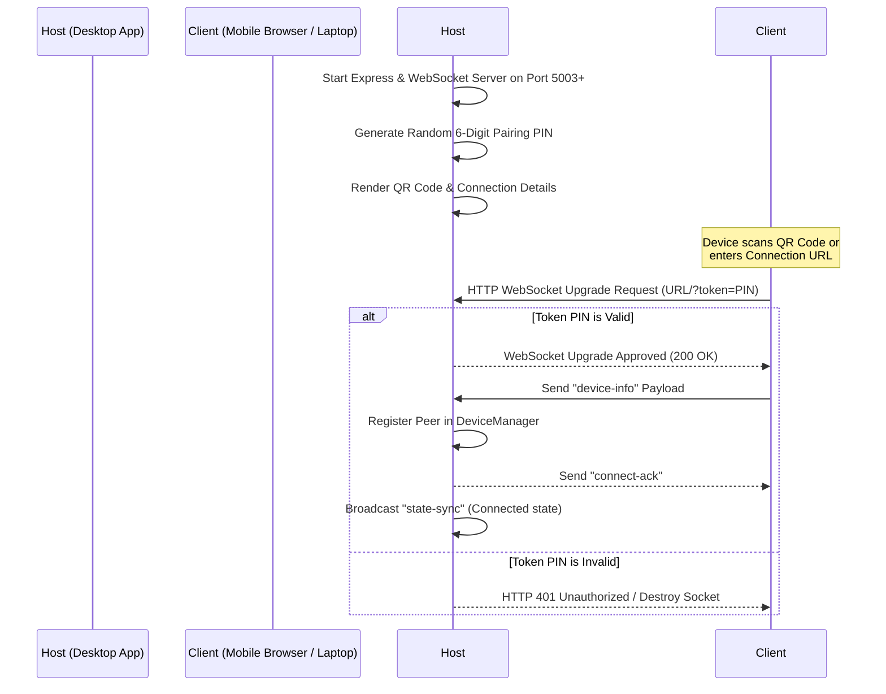
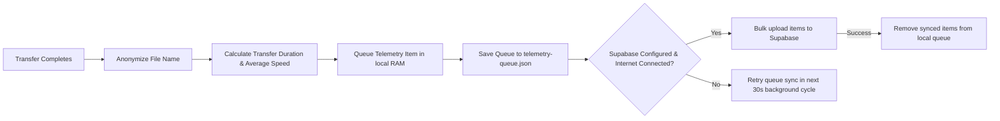

# Weshare 🚀

> **Premium, Offline-First Intranet Device-to-Device File Sharing Platform.**

Weshare is a local network file transfer application designed to transfer files, directories, and nested structures seamlessly between desktop computers, laptops, and mobile devices (Android) completely offline on your local network (LAN/Wi-Fi). 

Built with **Electron**, **React**, and **TypeScript**, it spins up a local Express server on your machine, enabling other devices to connect, handshake with a secure 6-digit Pairing PIN, and stream large gigabyte-sized files at maximum hardware speed.

---

## 🎨 Design Aesthetics & User Interface

The application interface features a premium custom dark-mode design system:
* **Glassmorphism**: Translucent panels utilizing `backdrop-filter: blur(20px)` and subtle glowing border highlights.
* **Ambient Neon Glows**: Soft violet (`#8b5cf6`) and cyan (`#06b6d4`) highlight animations and status indicators.
* **Micro-interactions**: Subtle hover scaling transitions, interactive button animations, and active state connection pulses.
* **Responsive Layouts**: Double-panel dashboard on desktop screens that dynamically scales down to single-column sheets on mobile screens.

---

## ⚡ Key Features

1. **Intranet Peer-to-Peer Transfers**: Files are streamed directly between devices on the local subnet. No cloud storage is used, preserving maximum local bandwidth speeds and complete file privacy.
2. **LAN Auto-Discovery**: Built-in UDP multicast sockets broadcast and listen for other desktop instances on the local subnet, eliminating manual IP address entries.
3. **High-Readability 6-Digit Pairing PINs**: Simple, secure numerical PINs (e.g. `582914`) allow users to pair laptops and mobile browsers with zero friction, replacing long cryptographic tokens.
4. **Segmented Pairing Portal**: Separates mobile pairing (glowing QR code scan) and laptop pairing (IP Address, PIN, and manual URL display) into structured tabs.
5. **Disk-Buffered Streaming Engine**: Integrates a clean Express and `multer` streaming pipeline to pipe incoming transfers directly to your `Downloads/Weshare` folder on disk, preventing Node processes from running out of RAM on large multi-gigabyte transfers.
6. **Multi-Part Parallel Chunk Uploads**: Supports splitting large files into chunks, uploading them, and reassembling them on disk, with support for pausing and resuming active transfers.
7. **Background Folder Zipping**: Offloads directory archiving to a dedicated background Node process (`zipWorker.ts`) via Electron `fork()` to maintain UI responsiveness when sharing folders.
8. **Offline Telemetry Sync**: Logs local transfer metrics (file sizes, durations, speeds, anonymized file names) in a local JSON-backed queue, and synchronizes them to a central Supabase database once an active internet connection is detected.
9. **Premium Admin Console**: Features a dashboard (`/admin`) to check transfer speed graphs, monitor average speeds, download transfer audits as CSV, and configure Supabase telemetry keys.
10. **Auto-Updater Framework**: Queries new versions on boot, shows a glassmorphic notification banner, downloads installer binaries, and launches setup wrappers to perform update cycles.

---

## 🛠️ Technology Stack

* **Desktop Application Wrapper**: Electron (v31.0.x) - For native OS integration, IPC, and filesystem access.
* **Frontend Core**: React (v18.3.x) + TypeScript (v5.4.x) + Vite (v5.3.x) - High performance UI and hot-reload.
* **Backend Core**: Express + WS (WebSockets) + Multer - Local HTTP file streaming and real-time event signaling.
* **Styling**: Custom CSS Custom Properties (Vanilla variables) - For dark mode glassmorphism and animations.
* **Metadata & Telemetry**: Supabase JS Client (v2.108.x) - Offline-first telemetry queue and release metadata updates.
* **Utilities**:
  * `adm-zip` - Creating/extracting directory transfer packages.
  * `qrcode` - Quick QR code generation for mobile client handshakes.
  * `lucide-react` - Premium vector iconography.
  * `concurrently` + `wait-on` - Synchronizing developer builds.

---

## 📊 Technical Architecture & Flows

### 1. Peer-to-Peer Device Pairing Handshake


### 2. Disk-Buffered File Streaming Engine
```mermaid
graph TD
    subgraph Sender
        A[Select File / Folder] -->|If Folder| B[Spawn zipWorker.ts child process]
        B --> C[Create temporary .zip archive]
        C --> D[Offer file ID via WS to Server]
        A -->|If File| D
    end

    subgraph Receiver (Client / Peer)
        D -->|WS: file-offered| E[Accept Transfer]
        E -->|WS: file-accepted| F[Initiate Native HTTP Stream Request]
    end

    subgraph Streaming Server (Host)
        F -->|GET /api/download/:fileId?token=PIN| G[Validate Token PIN]
        G -->|Authorized| H[fs.createReadStream]
        H -->|Pipe chunk-by-chunk| I[HTTP Response Stream]
        I -->|fs.createWriteStream| J[Write to Downloads/Weshare]
        J -->|If Folder| K[Extract Zip via adm-zip & delete .zip]
        K --> L[Complete Transfer State & Trigger Telemetry]
    end
```

### 3. Offline-First Telemetry Sync Queue


---

## 📂 Project Architecture

```
Weshare/
├── .github/
│   └── workflows/
│       └── build.yml              # GitHub Actions CI/CD release build pipeline
├── landing-page/                  # Tailwind-styled product showcase website
│   ├── index.html                 # Main website template
│   ├── logo.png                   # Landing page branding image
│   ├── image.png                  # Simulated app preview dashboard screenshot
│   └── Weshare Setup 1.0.0.zip    # Desktop setup installer package
├── src/
│   ├── main/
│   │   ├── main.ts                # Electron main window lifecycle, auto-updater, IPC & UDP broadcasts
│   │   ├── preload.ts             # OS bridges (filesystem, download/upload native triggers, config APIs)
│   │   └── zipWorker.ts           # Background child process for non-blocking folder zip compression
│   ├── server/
│   │   └── index.ts               # Local Express HTTP & WebSocket connection servers
│   ├── services/
│   │   ├── deviceManager.ts       # Network interface IP scraper, numeric PIN generator, peer states
│   │   ├── telemetryQueue.ts      # Offline-first SQLite/JSON telemetry buffer & Supabase connector
│   │   └── transferEngine.ts      # Stream trackers, file speeds, accepted state handlers
│   └── renderer/
│       ├── App.tsx                # Central coordinator, view states, auto-updater notification banners
│       ├── electron.d.ts          # TypeScript declarations for the exposed Electron APIs
│       ├── index.css              # Custom styling variables, glassmorphic layout components, pulses
│       ├── index.html             # React mount anchor
│       ├── main.tsx               # Renderer initialization entrypoint
│       └── components/
│           ├── AdminDashboard.tsx # Supabase telemetry charts, CSV audit exporter, API configurations
│           ├── Dashboard.tsx      # Main application dashboard layout, connected peer listing
│           ├── HistoryList.tsx    # Live transfer progress tracks, pause/resume loops, speeds
│           ├── Onboarding.tsx     # Swiper sliders introducing app permissions and functions
│           ├── PairingPortal.tsx  # QR and numerical PIN authentication code switcher tab hub
│           ├── ReceiveScreen.tsx  # Mobile-specific layout components for local downloads
│           └── SendScreen.tsx     # File selection triggers, file drop zones, progress handlers
├── package.json                   # Build scripts, project dependencies, electron-builder targets
├── vite.config.ts                 # React development & production bundling configurations
├── tsconfig.json                  # Central TypeScript setup referencing sub-targets
├── tsconfig.main.json             # Main process compiler settings
├── tsconfig.renderer.json         # Renderer UI process compiler settings
└── vercel.json                    # Single-page client routing rules for Vercel
```

---

## 🚀 Setup & Local Development

### 1. Prerequisites
Ensure you have the following installed:
* [Node.js](https://nodejs.org/) (v18.x or later recommended)
* [git](https://git-scm.com/)

### 2. Local Installation
Clone the repository and install the dependencies:
```powershell
# Clone the repository
git clone https://github.com/frankd3u9d39/Weshare.git
cd Weshare

# Install dependencies
npm install
```

### 3. Run Development Build
To boot the hot-reloading development server for both the Electron main process and the Vite renderer frontend:
```powershell
npm run dev
```
* Vite will mount the UI on `http://127.0.0.1:5773`.
* The Express server will spin up on preferred port `5003` (with auto-incrementing fallback).
* UDP Autodiscovery will start broadcasting signals on port `5774`.

### 4. Telemetry Setup (Supabase)
To enable real-time telemetry syncing:
1. Create a Supabase project at [supabase.com](https://supabase.com/).
2. Run the following SQL query in your Supabase SQL Editor to initialize the telemetry table:
   ```sql
   create table transfers_telemetry (
     id bigint generated by default as identity primary key,
     transfer_id text not null unique,
     file_name text not null,
     file_size bigint not null,
     file_type text,
     sender_device text,
     sender_os text,
     receiver_device text,
     receiver_os text,
     status text check (status in ('completed', 'failed')),
     speed_bytes_sec double precision,
     duration_sec double precision,
     error_message text,
     created_at timestamp with time zone default timezone('utc'::text, now()) not null
   );
   ```
3. Open Weshare, navigate to the Admin Dashboard (`/admin` panel by clicking the gear/admin icon in the dashboard header).
4. Enter your **Supabase URL** and **Anon API Key** into the configuration input fields and save.
5. The credentials will be saved locally to `weshare-config.json` inside your local app settings path.
6. The app will automatically begin uploading queued logs over the internet.

---

## 📦 Production Compilation & Packaging

### Standalone Production Build
To bundle the frontend components and compile TypeScript sources:
```powershell
npm run build
```

### Desktop Packaging
To compile, sign, and package the desktop app into compressed standalone setup installer files:
```powershell
# Package for the active platform
npm run package

# Package specifically for macOS DMG target
npm run package:mac

# Package specifically for Linux tar.gz target
npm run package:linux
```
*All generated installer packages are saved inside the `/release` directory.*

---

## ⚙️ Under-The-Hood Technical Deep Dives

### 1. LAN UDP Auto-Discovery Service
Weshare uses node `dgram` UDP sockets on port `5774` to automatically discover nearby desktop instances on the local subnet without central cloud coordination:
* **Broadcast**: Every 10 seconds, the main process broadcasts `WESHARE_DISCOVER` packets to address `255.255.255.255`.
* **Listen**: Incoming messages are parsed. If a peer receives a discovery request, it queries `deviceManager.ts` to retrieve local interfaces and replies directly to the client's socket with its `WESHARE_DEVICE_RESPONSE` containing its device name, Express server port, OS, and WebSocket Pairing PIN.
* **Notification**: When a device response is parsed, it is forwarded through the IPC bridge `device-discovered` to the React dashboard peer listing immediately.

### 2. Numerical Pairing PIN Security & Upgrade Flow
When a mobile phone or secondary laptop tries to connect, standard browser security policies apply. To establish real-time socket channels:
* The pairing URL contains a validation query parameter (e.g., `https://192.168.1.15:5003/?token=582914`).
* All traffic is HTTPS/WSS using a self-signed certificate generated on first run (stored in the app's `userData/tls` folder). The pairing PIN is never sent over LAN discovery.
* WeShare desktops pin each other's certificate fingerprint (learned from discovery or the first connection) and refuse a connection if it changes. Phone browsers show a one-time "not private" warning; the pairing screen shows the start of the fingerprint so it can be checked.
* File offers are routed only to the chosen device, and the server rejects uploads/downloads that the receiver has not accepted.
* Incoming WebSocket upgrades intercept the HTTP `upgrade` lifecycle events inside `src/server/index.ts`.
* The server parses the connection URL query parameters, extracts the token, and calls `deviceManager.validateToken()`.
* If unauthorized, the connection is instantly rejected with `HTTP/1.1 401 Unauthorized`.
* If authorized, the WebSocket upgrade is approved, and full real-time event synchronization begins.

### 3. Disk-Buffered Streaming Pipeline
For multi-gigabyte transfers, storing files in RAM leads to memory-exhaustion. Weshare implements a streaming pipeline using standard Node.js Streams:
* **Express & Multer**: Multer streams uploads straight to disk using temporary `.chunks` subdirectories on `/api/upload-chunk` calls.
* **Chunk Reassembly**: Once all chunks are verified to be written, the server runs a chunk merge operation using sequential read/write pipe buffers to merge the segments into a single file before cleaning up temporary paths.
* **Directory Archiving**: Zipping folders runs in a separate child process using the `zipWorker.ts` script. This avoids blocking Electron's single-threaded event loop. Upon receipt, the zip archive is extracted via `adm-zip` and the temporary zip file is cleaned.

---

## 🛠️ Troubleshooting & FAQ

#### Q: The Pairing QR Code is not loading, or the mobile device says "Connection Timed Out".
* **Same Network (Subnet)**: Ensure that your desktop computer and your mobile/client device are connected to the exact same Wi-Fi access point or local network. Some guest Wi-Fi networks block client-to-client intranet communication.
* **IP Interface Selection**: If you have multiple network interfaces enabled (e.g., VirtualBox Ethernet adapters, WSL adapters, active VPN connections), open the pairing portal, click the **Select LAN Interface** dropdown, and choose your active Wi-Fi network interface IP (typically starts with `192.168.x.x` or `10.x.x.x`).
* **Firewall Access Block**: When booting Weshare for the first time, Windows/macOS Firewall may prompt to allow network access. Make sure to allow incoming network connections for Node/Electron. You may need to manually add an inbound firewall port rule for ports `5003`, `5773`, and `5774`.

#### Q: My phone says "Your connection is not private".
* Expected the first time. WeShare encrypts traffic with a certificate made by your computer, which phone browsers can't check against a public authority. Tap **Advanced → Proceed**. To be sure you reached your computer, compare the certificate's SHA-256 with the code on the pairing screen.

#### Q: Updates are not offered / "failed its security check".
* Every release needs a SHA-256 checksum for its platform. Publish from the Admin Console (it records checksums automatically) and run `supabase/security.sql` once to add the columns and lock down who can publish.

#### Q: The telemetry queue is not syncing stats to the Database.
* Verify that you have saved the correct Supabase URL and API keys in the dashboard config settings under the `/admin` screen.
* Ensure your desktop device has an active internet connection. The Express/WS file transfer engine functions entirely offline, but telemetry logs sync requires external internet connectivity to reach Supabase.

#### Q: How can I change the default downloads storage directory?
* Open the application settings or the Admin Panel, navigate to **Downloads Folder**, and choose a new destination folder. The default path is `C:\Users\<User>\Downloads\Weshare` on Windows.
